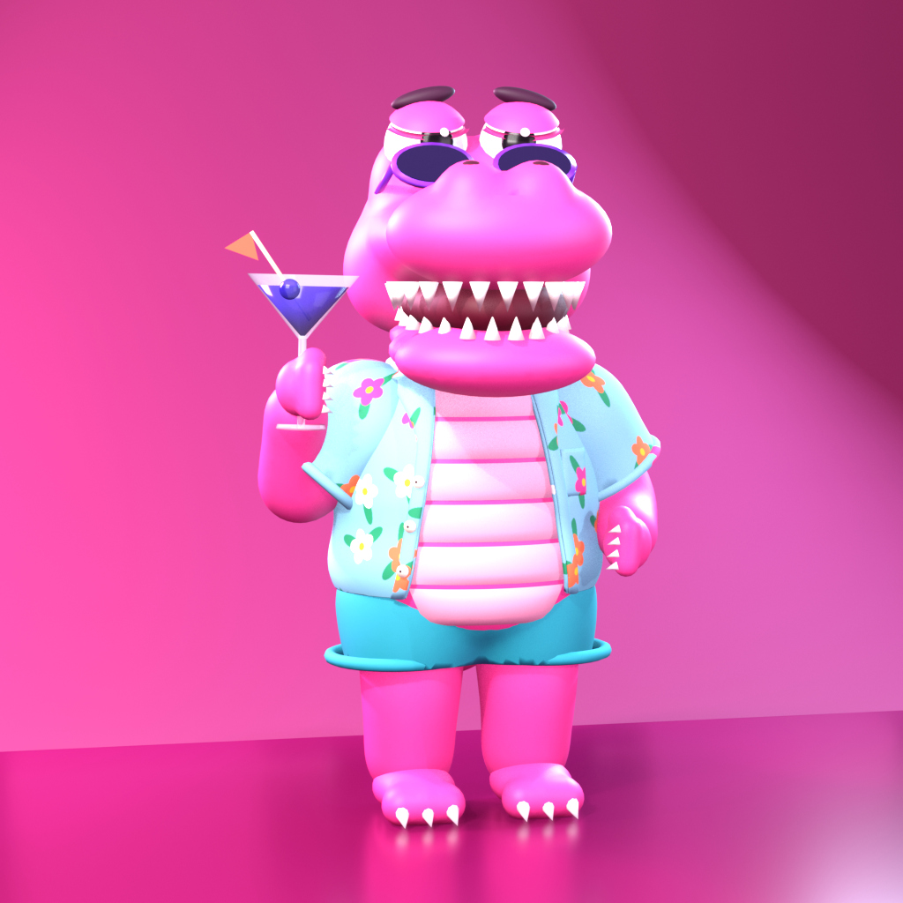

<p align="center"></p>

# Macca the Gator

A GTA-style browser game set in **Leonida**, a little beach town down the coast from Sol City.
Macca, a pink gator in a Hawaiian shirt, runs the Gator Bar, and today is the big Beach Party.

Built with [three.js](https://threejs.org) (loaded from the jsDelivr CDN); no build step.

## Run

```bash
node serve.js
```

Then open http://localhost:5173/ (the game is the whole site: `index.html` at the root).

The page must be served over HTTP: opening `index.html` straight from disk can't load the models.
To deploy, publish the repository root as a static site (`blender/` and `tools/` are only needed for rebuilding).

## The game

- **Six story missions**, started at the yellow beam at the Gator Bar door: Happy Hour, Pink Pearl, Hot Wheels,
  Croc Brothers, Heat Wave and the Beach Party finale.
- **On foot**: walk, run, jump, bite + tail whip, sip a cocktail to heal, dance, swim.
- **Cars**: get in or carjack (F), drift, nitro, stunt ramp on the beach; traffic follows lanes and lights.
- **Police**: 1–5 wanted stars, cruisers that route through town and ram, officers on foot, a helicopter from 3 stars.
- **Town life**: ~80 pedestrians, swimmers, seagulls, pelicans, flamingos, dogs, crabs and dolphins.
- Hidden flamingos, beach balls, boats, a ferris wheel on the pier, a lighthouse and a hill sign.
- Press **? / Tab** in the game for all the controls, the map and the mission list.
- Graphics: **P** cycles LOW / HIGH / ULTRA; on a slow machine the game steps down by itself.

### Site settings

The contract address box and the Telegram link live in [`src/site.js`](src/site.js):

```js
ca: '',        // contract address (empty shows "COMING SOON")
telegram: '',  // e.g. 'https://t.me/yourgroup'
```

## Files

| Path | What |
|---|---|
| `index.html`, `src/` | the game (world, player, vehicles, people, police, missions, animals, beach, HUD, audio) |
| `assets/models/` | Macca, the cars, the police helicopter and the townsfolk (GLB) |
| `assets/logo.png`, `assets/favicon-*`, `favicon.ico` | logo and favicons |
| `blender/gator.blend`, `blender/gator.glb` | Macca's Blender source, rigged and animated |
| `tools/build_gator.py` | Blender script that models, rigs and animates Macca and exports the GLB |
| `serve.js` | tiny static file server |

Rebuild Macca (Blender 4.2+):

```bash
blender -b --factory-startup --python tools/build_gator.py -- blender
cp blender/gator.glb assets/models/gator.glb
```

## Credits

- Cars, police helicopter and the people setup come from the Sol City project.
- Townsfolk and their motion: [Microsoft Rocketbox](https://github.com/microsoft/Microsoft-Rocketbox) avatars (MIT licence).
- All sound and music is synthesized live with WebAudio.

## Disclaimer

Unofficial fan-made project. Not affiliated with, endorsed, sponsored or approved by Rockstar Games or
Take-Two Interactive. Grand Theft Auto, GTA, Vice City, Leonida and Macca the Gator are trademarks or properties
of their respective owners. Nothing here is financial advice; crypto is risky.
